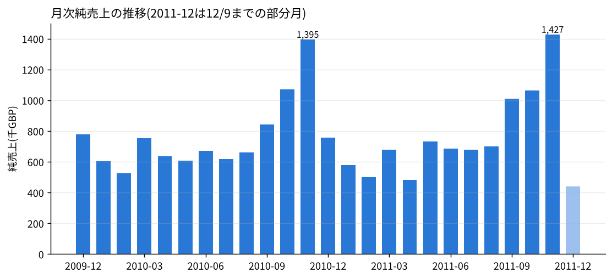
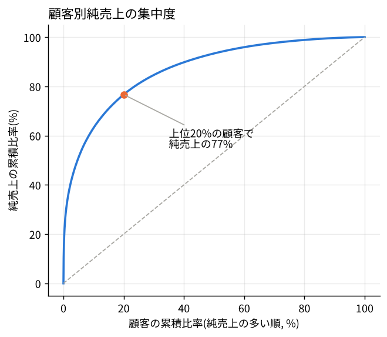
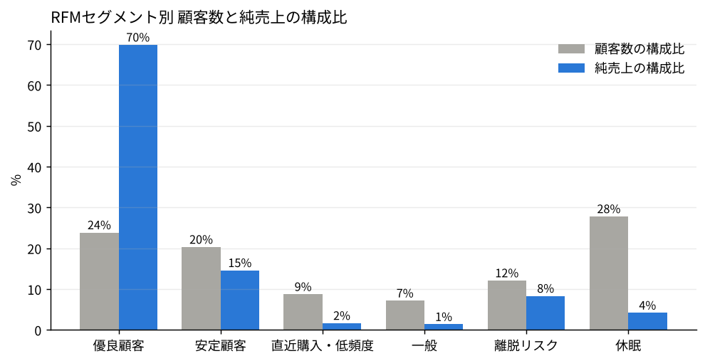
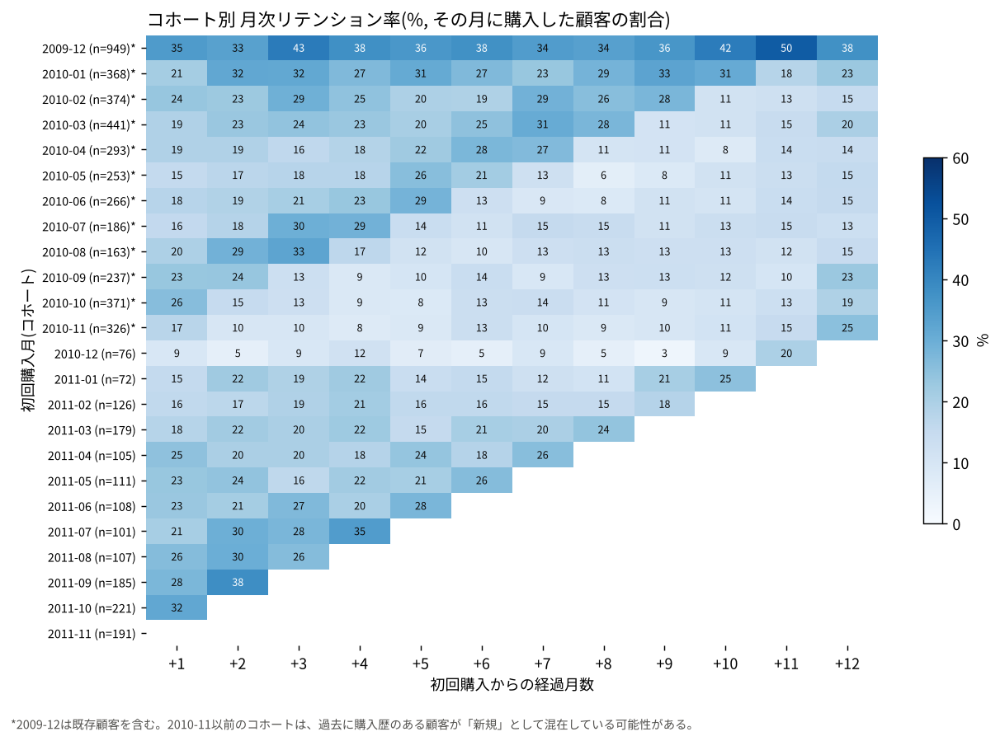
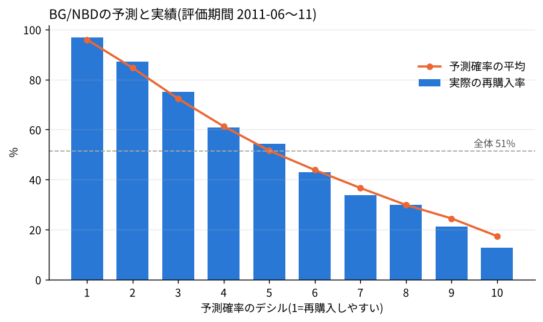

# ECサイト顧客・リテンション分析

## 目次

1. はじめに
   - 1.1 背景と目的
   - 1.2 分析の問い
   - 1.3 結論の要約
2. データと前処理
   - 2.1 データ概要
   - 2.2 データ品質の確認と前処理
   - 2.3 分析上の主要な定義
3. 分析結果
   - 3.1 売上の全体像
   - 3.2 顧客セグメント分析(RFM)
   - 3.3 コホート分析
   - 3.4 再購入予測
4. 提案
   - 4.1 優先順位
   - 4.2 実行の進め方
   - 4.3 効果検証の考え方
5. 限界と今後の課題
6. 付録
   - 付録A 用語・指標の説明
   - 付録B 分析手法
   - 付録C 補足分析・検証
   - 付録D ファイル構成と再現手順
   - 付録E 参考文献・データの出典

---

## 1. はじめに

### 1.1 背景と目的

本分析の対象は、英国のオンライン小売事業者である。ギフト雑貨を扱い、顧客には卸売業者が多い。既存顧客の維持(リテンション)を高めるには、限られた人員・リソースの中で、どの顧客に優先的にアプローチするかを決める必要がある。

本分析は、過去2年間の購買データをもとに、売上構造と顧客の購買行動を多角的に把握し、リテンションの向上に向けた施策の優先順位付けに役立つ示唆を得ることを目的とする。

### 1.2 分析の問い

1. 売上の構造: 売上の季節性や国別・顧客別の構成から、売上はどの市場・顧客層に依存しているか。
2. 顧客価値と離脱リスク: 売上への貢献度が高い優良顧客と、離脱リスクの高い顧客はどのセグメントか(RFM分析)。
3. 顧客の定着: 新規顧客は、獲得後にどの程度購入を続けているか(コホート分析)。
4. 再購入の予測: 各顧客が今後6か月以内に再購入する確率を予測できるか。その予測は働きかけの優先順位付けに使えるか(予測モデルの性能評価)。

### 1.3 結論の要約

- 売上は9〜11月に集中する。1〜11月の純売上は前年比で横ばいであり、注文数の減少を、1注文あたり純売上の増加が補っている。
- 優良顧客(顧客の23.9%)が顧客別売上の69.9%を占め、少数の顧客への依存が大きい。
- 過去に繰り返し購入しながら長期間購入していない「離脱リスク」の顧客(706人)は、評価期間の実績で、休眠の顧客より再購入率も1人あたり購入額も高い。働きかけの優先度は離脱リスクのほうが高い。
- 新規顧客のうち、初回購入から90日以内に再購入したのは約4割で、約6割は2回目の購入に至っていない。
- 再購入は、購入回数・最終購入時期・観測期間の3つからBG/NBDで予測でる。ただし、購入額の確保には、過去の純売上が多い順のほうが強い基準である。

---

## 2. データと前処理

### 2.1 データ概要

英国の小売事業者のオンライン取引データ約2年分を使用した。UCI Machine Learning Repositoryで公開されている「Online Retail II」である。

| 項目 | 内容 |
| --- | --- |
| 元データの行数 | 1,067,371行 |
| 分析対象 | 前処理後 1,024,196行 |
| 期間 | 2009-12-01〜2011-12-09 |
| 主な列 | 伝票番号、商品コード、商品名、数量、取引日時、単価、顧客ID、国 |
| 通貨 | 英ポンド(GBP)。換算は行っていない |
| 顧客IDの欠損 | 前処理後の行数ベースで22.4%(純売上ベースで13.6%) |
| 国数 | 43か国。純売上の85.4%は英国 |

1行は1つの伝票内の1商品に対応する。伝票番号が「C」で始まる行は取消(返品)である。顧客IDが欠損している取引は、売上の集計には含め、顧客単位の分析(RFM・コホート・予測)からは除外した。

### 2.2 データ品質の確認と前処理

前処理の結果、分析対象は1,024,196行になった。2シートの重複期間と完全重複行の除去が大半で、除外した行数は次のとおりである。

| 処理 | 除外行数 | 理由 |
| --- | --- | --- |
| 重複期間の除去 | 22,523 | 2010-12-01〜12-09が両シートに収録されていたため |
| 完全重複行の除去 | 11,812 | 全列が一致する行を重複入力とみなした |
| 不良債権調整の伝票(「A」で始まる)の除去 | 6 | 売上ではない会計調整のため |
| 単価0以下の行の除去 | 6,014 | 無償提供・在庫調整等のため |
| 誤発注の相殺 | 2,820 | 下記参照(購入1,410行+取消1,410行) |

**誤発注の相殺**: 24時間以内に、同一顧客・同一商品・同一数量で取消された注文は、返品ではなく入力ミスの可能性が高いと判断し、購入と取消の両方を除外した。代表例は2011-12-09の80,995個(£168,470)の注文と直後の取消、2011-01-18の74,215個(£77,184)の注文と取消である。除外しない場合、2011年12月の売上と返品率が実態より大きくずれる。

**商品以外のコード**: 送料(POST)、手数料(BANK CHARGES)、手動調整(M)、ギフト券等の5,744行にはフラグを付け、商品別の分析では除外した(購入額に占める割合は3.8%)。

**感度分析**: 誤発注の相殺の時間幅(なし〜30日)と完全重複行の除去の有無を変えても、純売上は£18.87M〜£18.94M(基準との差は最大0.3%)、優良顧客の売上構成比は69.7〜69.9%、上位20%顧客の売上構成比は76.6〜76.7%で、結論に影響する変化はない。相殺は購入と取消を同時に除くため純売上はほとんど動かず、返品率だけが条件に左右される(相殺なし3.6%、30日1.3%)。詳細は付録C.1に示す。

### 2.3 分析上の主要な定義

- **総売上**: 購入明細(商品コードのみ)の「数量×単価」の合計。
- **返品**: 取消伝票の同合計の絶対値。
- **純売上**: 総売上から返品を引いた額。期間全体では、総売上£19.25M、返品£0.37M(総売上の1.9%)、純売上£18.89Mとなった。
- **顧客別売上**: 顧客IDのある取引に限った純売上。期間通算で純売上が正の顧客5,837人の合計は£16.3Mで、純売上全体の86.4%にあたる。顧客別の構成比(上位20%・RFMセグメント)は、この金額を分母とする。
- **新規顧客**: 初回購入の前12か月間に購入履歴がない顧客。データの開始が2009-12のため、2010年12月以降に初めて購入した顧客が該当する。
- **基準日・評価期間**: 予測を行う時点を基準日、その後180日間を予測期間とする。評価は基準日2011-06-01、予測期間2011-06〜11で行った。

---

## 3. 分析結果

### 3.1 売上の全体像

売上は9〜11月に集中する。2010年は9〜11月の純売上が年間(2010年1〜12月)の36.2%を占め、月別の最大は両年とも11月(2010年£1.39M、2011年£1.43M)である。季節性の比率は、通年が揃う2010年でのみ算出した。

**前年同期比**: 1〜11月の純売上は前年比+1.9%(£8.38M→£8.54M)で、ほぼ横ばいである。内訳を見ると、注文数は−3.7%(18,023件→17,351件)、1注文あたりの純売上は+5.8%(£465→£492)であり、注文件数の減少を1件あたりの純売上の増加が補っている。購入のあった顧客数は+1.0%(4,124人→4,167人)だった。

**国別**: 英国が純売上の85.4%を占める。次いでアイルランド(EIRE)が3.2%だが、購入した顧客は3人のみで、特定顧客への依存度が高い。

**顧客への集中**: 純売上が正の顧客5,837人のうち、上位20%の顧客が顧客別売上の76.7%、上位10%が63.1%、上位1%が31.0%を占める。

**返品**: 返品率は期間全体で1.9%と低い。月別では2011年4月が6.2%と突出するが、これは1件の大口取消(£22,998、同月の返品額の73%)による。

### 3.2 顧客セグメント分析(RFM)

優良顧客は全体の23.9%(1,393人)にすぎないが、顧客別売上の69.9%を占める。一方、過去に繰り返し購入しながら長期間購入が途絶えた「離脱リスク」の顧客が706人(12.1%)おり、その過去の純売上は£1.36M(8.3%)に上る。

基準日は2011-12-10とし、対象は購入実績があり、期間通算の純売上が正の5,837人とした。顧客を最終購入からの経過日数(R)と購入回数(F)のスコアで分類した(手法の説明は付録B.1)。

- R(5段階): 経過日数の5分位。5=0〜19日、4=20〜58日、3=59〜186日、2=187〜408日、1=409日以上
- F(5段階): 購入伝票数。1回=1、2回=2、3〜4回=3、5〜9回=4、10回以上=5(同点が多いため固定のしきい値とした)

セグメントはRとFのスコアで次のように定義した(Mは分類に使わない)。「直近購入・低頻度」は最近購入したが購入回数が少ない顧客で、「新規顧客」(2.3節)とは別の定義である。

| セグメント | 定義 | 顧客数 | 顧客構成比 | 純売上構成比 | 最終購入からの平均日数 | 平均購入回数 |
| --- | --- | --- | --- | --- | --- | --- |
| 優良顧客 | R≧4 かつ F≧4 | 1,393 | 23.9% | 69.9% | 19 | 16.1 |
| 安定顧客 | R≧3 かつ F≧3(優良を除く) | 1,186 | 20.3% | 14.6% | 76 | 5.6 |
| 直近購入・低頻度 | R≧4 かつ F≦2 | 510 | 8.7% | 1.7% | 27 | 1.5 |
| 一般 | R=3 かつ F≦2 | 418 | 7.2% | 1.4% | 107 | 1.4 |
| 離脱リスク | R≦2 かつ F≧3 | 706 | 12.1% | 8.3% | 359 | 5.5 |
| 休眠 | R≦2 かつ F≦2 | 1,624 | 27.8% | 4.2% | 453 | 1.3 |

購入回数が2回以上の顧客は72.5%で、1回のみの顧客が27.5%を占める。離脱リスク(706人)は休眠(1,624人)より人数が少ないが、1人あたりの過去の購入額が大きい(離脱リスク£1,925、休眠£420)。離脱後の再購入の見込みは3.4節で比べる。

### 3.3 コホート分析

初回購入月が同じ顧客を1つの集団(コホート)とし、その後の月ごとの購入有無を追った(手法の説明は付録B.2)。対象は、初回購入の前12か月間に購入履歴がない「新規顧客」(2.3節)である。

新規顧客のうち、初回購入の翌日から90日以内に再購入したのは40.4%で、約6割は2回目の購入に至っていない。対象は、90日間を観測できる2011-09までの初回購入者1,017人である。月次で見ても、初回購入の1か月後に購入した顧客は22.8%、3か月後は20.8%、6か月後は17.9%にとどまる。

次の表は、各月に購入した顧客の割合(リテンション率)を示す。

| 対象 | M+1 | M+3 | M+6 | M+12 |
| --- | --- | --- | --- | --- |
| 2009-12を除く全コホート | 20.9% | 21.2% | 18.5% | 18.5% |
| 2010-12以降の新規顧客 | 22.8% | 20.8% | 17.9% | 観測不可 |

M+nは、その月に購入した顧客の割合であり、累積ではない(90日以内の再購入率とは別の指標である)。2010-12以降の新規顧客のM+12は、2011-11までしか観測できないため算出できない。

**解釈上の注意**

- データの開始が2009-12のため、2009-12コホート(949人)は既存顧客を含み、リテンション率が高く出る。2010年のコホートにも、過去に購入歴のある顧客が「新規」として混在する可能性がある。クリーンな新規顧客として扱えるのは、2010-12以降の初回購入者である。
- コホートの人数は2010年1〜6月が平均333人、2011年1〜6月が平均117人と大きく異なるが、上記の混在の影響を受けるため、新規顧客の獲得数が減ったとは判断できない。
- 月次リテンション率は、観測する月の繁閑に左右される(秋に初めて購入した顧客のM+1〜M+3は閑散期の12〜2月と重なる)。90日以内再購入率の対象のうち、初回購入が秋(9〜11月)なのは2011-09の32人のみで、初回購入時期による再購入率の違いは判断できない。

### 3.4 再購入予測

各顧客が基準日から180日以内に再び購入するかを、購入回数・最終購入時期・観測期間の3つの情報から予測できる。主モデルには、契約のない小売の顧客分析で標準的なBG/NBDを用いた。設計(目的変数、検証方法、入力、比較対象)は付録B.3に示す。評価期間(2011-06〜11)の対象4,906人のうち、実際に再購入したのは51.5%である。予測確率が高い順に並べると、上位10%の顧客の96.7%が再購入し、下位10%では12.8%だった。

#### モデルの選択と比較

最初の候補は、特徴量を加えやすく、係数から要因を読み取れるロジスティック回帰だった。比較すると、購入頻度と離脱確率の個人差を確率分布で表すBG/NBD(Fader, Hardie & Lee, 2005)のほうが、購入回数・最終購入時期・観測期間の3つだけで精度が高かった(次の表)。ロジスティック回帰にBG/NBDの再購入確率や購入日数などを加えて改善を試みたが、AUCは0.792〜0.805で、BG/NBD単独(0.810)を上回らなかった。このため主モデルをBG/NBDとした。BG/NBDは基準日以前のデータだけで推定でき、学習用の別時点もハイパーパラメータの調整も要らない。

評価指標はAUC(0.5が無作為、1.0が完全。定義は付録A)である。95%信頼区間はブートストラップ法(評価データの再抽出1,000回)で求めた。

| モデル | AUC | 95%信頼区間 |
| --- | --- | --- |
| BG/NBD(主モデル) | 0.8104 | 0.7990〜0.8213 |
| ロジスティック回帰(単一時点で学習) | 0.7877 | 0.7757〜0.7994 |
| ロジスティック回帰(3時点を合わせて学習) | 0.7855 | 0.7727〜0.7973 |
| 勾配ブースティング(3時点) | 0.7833 | 0.7716〜0.7953 |
| 単純ルール(最終購入が新しい順) | 0.7652 | 0.7517〜0.7778 |

BG/NBDのAUCは、単純ルールを0.045(差の95%区間+0.037〜+0.053)、ロジスティック回帰(3時点)を0.025(区間+0.018〜+0.031)上回る。ロジスティック回帰と単純ルールの差は+0.020(区間+0.014〜+0.026)にとどまる。勾配ブースティングは、3時点で学習したロジスティック回帰を上回らなかった。単一時点(0.7877)と3時点(0.7855)のロジスティック回帰の差は0.0022で、95%区間は大きく重なる。基準日を5時点に変えても、BG/NBDはいずれの基準日でも単純ルールを上回った(付録C.2)。

#### 予測確率の使い方

BG/NBDの予測確率と実績の差は、全デシルで5ポイント以内(最大は第10デシルの4.5ポイント。予測17.3%・実績12.8%)に収まり、実績は第1デシルから第10デシルまで単調に低下する。確率の絶対値も目安として使えるが、基本は顧客の優先順位付けに使う。

#### 購入額の捕捉率

施策の対象を上位N%に絞ったとき、評価期間(2011-06〜11)の購入額全体の何%を対象に含められるか(捕捉率。再購入率とは別の指標)を、並べ方ごとに比べた。

| 並べ方 | 上位10% | 上位20% | 上位30% |
| --- | --- | --- | --- |
| 過去の純売上が多い順 | 62.4% | 75.2% | 82.4% |
| BG/NBD+Gamma-Gammaの期待売上 | 58.4% | 72.8% | 82.2% |
| BG/NBDの再購入確率 | 57.5% | 70.7% | 79.0% |
| ロジスティック回帰の予測確率 | 57.5% | 70.0% | 76.9% |
| 最終購入が新しい順 | 38.5% | 63.7% | 73.3% |
| 無作為 | 10.0% | 20.0% | 30.0% |

過去の純売上順は、上位20%で75.2%を捕捉し、再購入確率順(70.7%)を約4ポイント上回る(差の95%区間−7.2〜−2.2ポイント)。期待売上順(72.8%)も、過去の純売上順には届かない(差は約2ポイント、区間−4.0〜−1.0ポイント)。過去の購入額が大きい顧客は評価期間も購入額が大きい傾向があり、購入額を確保する目的では過去の純売上が強い基準になる。一方、再購入確率順は最終購入が新しい順(63.7%)を約7ポイント上回る(区間+5.0〜+9.6ポイント)。期待売上順は上位30%で82.2%となり、過去の純売上順(82.4%)とほぼ並ぶ。ロジスティック回帰との差は小さく(再購入確率順で+0.8ポイント、区間−0.3〜+2.1ポイント)、捕捉率ではBG/NBDの優位は確認できなかった。いずれも評価期間1期間の結果である。

予測が上乗せするのは購入額の大きさではなく、再購入するかどうかの見分けである。その価値は、次に示す離脱リスクのように、過去の純売上と今後の購入が乖離する層で表れる。

#### セグメント別の実績

「過去に多く買った」と「今後買う」の違いを見るため、評価時点(2011-06-01)の購入履歴だけでRFMセグメント(3.2節と同じ規則)を分類し直し、評価期間の実績と比べた。

| セグメント | 顧客数 | 過去の純売上構成比 | 評価期間の再購入率 | 評価期間の購入額構成比 | 評価期間の1人あたり購入額 |
| --- | --- | --- | --- | --- | --- |
| 優良顧客 | 1,108 | 69.0% | 89.2% | 72.6% | £2,700 |
| 安定顧客 | 924 | 14.4% | 64.7% | 13.1% | £586 |
| 直近購入・低頻度 | 517 | 2.2% | 50.7% | 4.4% | £347 |
| 一般 | 407 | 1.5% | 30.5% | 1.5% | £151 |
| 離脱リスク | 477 | 7.0% | 41.9% | 3.6% | £308 |
| 休眠 | 1,473 | 5.9% | 24.0% | 4.8% | £135 |

離脱リスクは、過去の純売上では7.0%を占めるが、評価期間の購入額では3.6%にとどまり、過去の購入額ほどには今後の購入に結びつかない。それでも再購入率は41.9%、1人あたり購入額は£308で、休眠(24.0%、£135)を上回る。優良顧客は過去の純売上の69.0%に対し、評価期間の購入額の72.6%を占め、過去と今後の両面で中心である。

#### 離脱リスク内の絞り込み

評価時点の離脱リスク477人のうち、期待売上(再購入確率×1注文あたり金額)が高い上位50人の評価期間の購入額は£58.1Kで、過去の純売上順(£39.1K)や再購入確率順(£15.6K)より大きい。上位100人でも、期待売上順£77.1K、過去の純売上順£68.5K、再購入確率順£33.4Kの順だった。再購入確率だけで選ぶと購入額の小さい顧客が上位に来るため、1注文あたり金額との組み合わせが要る。標本が小さく、差の不確実性は評価していないため、参考値として扱う。

---

## 4. 提案

### 4.1 優先順位

働きかけの優先度は、評価期間の実績から見た「今後の購入見込み」と「上積みの余地」を踏まえ、①離脱リスクの顧客、②優良顧客の離脱の予兆、③初回購入から90日以内の新規顧客、の順に高いと考える。1人あたりの購入額が最も大きいのは優良顧客(£2,700)だが、89.2%がすでに再購入しており、働きかけによる上積みの余地は離脱リスク(再購入率41.9%)より小さい可能性がある。ただし上積みの大きさは本データでは測れない。以下は分析結果に基づく提案であり、各施策の効果の大きさは推定していない。

| 優先度 | 施策 | 根拠 | 実行内容・留意点 |
| --- | --- | --- | --- |
| 1 | 離脱リスクの顧客(706人)への個別連絡。対象内は期待売上の高い順に着手する | 過去平均5.5回購入しながら、最終購入は平均359日前。評価時点の分類では、休眠より再購入率・1人あたり購入額が高い(3.4節)。過去の純売上は£1.36M(8.3%)だが、評価期間の購入額への寄与は3.6% | 担当者からの連絡、限定案内など。対象内の並べ方は3.4節 |
| 2 | 予測確率が下がった優良顧客(1,393人)の早期検知と先回りの連絡 | 顧客の23.9%が顧客別売上の69.9%を占め、上位1%の顧客だけで31.0%を占める。評価時点の優良顧客も、評価期間の購入額の72.6%を占めた | すでに再購入率が高く(89.2%)、上積みの余地は離脱リスクより小さい可能性がある |
| 3 | 新規顧客に対する、初回購入後90日以内の再購入を促すフォロー(2回目の購入特典など) | 90日以内に再購入するのは40.4%で、約6割は再購入しない | 新規顧客の定義は2.3節。初回購入時期による再購入率の違いは判断できない(3.3節) |
| 4 | 繁忙期(9〜11月)前の優良・安定顧客への事前案内、在庫・人員の確保 | 2010年の純売上の36.2%が9〜11月に集中。11月は£1.4M前後 | 繁忙期に入る前に実施する |
| 5 | 注文件数の維持(定期発注の提案など) | 1〜11月の注文数は前年比−3.7%。1注文あたり純売上が+5.8%上昇し、純売上は+1.9%と横ばいを保った | 対象は全顧客 |

休眠(1,624人)は人数が多いが、純売上構成比は4.2%、1人あたりの過去購入額は£420と小さい。評価時点の分類でも再購入率と1人あたり購入額が離脱リスクを下回るため(3.4節)、一斉メール等の低コストな施策にとどめるのが妥当である。

### 4.2 実行の進め方

着手のしやすさは、対象リストを既存の分析結果から作れるか、予測の運用が必要か、実施時期に制約があるかで分かれる。

- **すぐに着手できる施策**: 施策1と3である。施策1の対象(離脱リスク706人)はRFMで特定済みである。対象内の並べ替えに使う期待売上は、BG/NBDとGamma-Gammaを最新の基準日(2011-12-10)で推定し直して作る(本分析で期待売上を算出したのは評価時点の2011-06-01のみ)。施策3の対象は、初回購入からの経過日数で抽出できる。
- **仕組みづくりを要する施策**: 施策2は、予測確率を定期的に更新し、確率が下がった優良顧客を抽出する運用が必要である。施策5は、定期発注の提案など、顧客ごとの商談の進め方を整える必要がある。
- **時期を合わせる施策**: 施策4は、次の9〜11月の前に実施する。

### 4.3 効果検証の考え方

本分析は観察データに基づく関連であり、施策の効果は本データでは検証できない。効果の測定には、A/Bテストを用いる。

#### A/Bテスト設計案

対象リスト(例: 離脱リスクの顧客)を無作為に介入群と対照群に分け、対照群には連絡しない。主要指標は連絡後90日以内の再購入率と1人あたり純売上、副次指標は返品率と配信停止率とし、判定基準は実施前に決める。必要人数は、対照群の再購入率と検出したい差から事前に計算する。たとえば再購入率を41.9%から46.9%に高めたい場合、有意水準5%・検出力80%の両側検定で1群あたり約1,550人が必要になる。評価時点の離脱リスクは477人のため、対象の拡大か複数期間の蓄積が要る。実施中は、介入群と対照群で他の販促を同じ条件にそろえる。

---

## 5. 限界と今後の課題

**限界**

- 1事業者・約2年分のデータであり、結果を他の事業者や市場に一般化することはできない。季節性の比率(3.1節)は、通年が揃う2010年のみで算出した。
- 顧客IDが欠損している取引(純売上の13.6%)は、顧客単位の分析(RFM・コホート・予測)から除外している。
- データの開始が2009-12のため、2009-12コホートと2010年のコホートには既存顧客が混在する。新規顧客の獲得数の推移は判断できない。
- 2011年12月は12/9までのデータしかない。月次の図では区別して表示し、コホート分析には含めていない。
- 重複行の除去(全列一致の行)と誤発注の相殺(24時間以内の同一内容の取消)は分析者の判断による処理である。感度分析(付録C.1)では純売上とセグメント構成比はほぼ変わらなかったが、返品率は相殺の条件に左右される(1.3〜3.6%)。
- RFMのセグメント境界は分析者の定義であり、しきい値を変えると構成比は変わる。
- 予測モデルのAUCは基準日5時点で確認したが、購入額の捕捉率や離脱リスク内の絞り込みの比較は、2011-06〜11の1期間のみである。絞り込み(上位50人・100人)は標本が小さく、差の不確実性は評価していない。
- 予測モデルの特徴量は購買履歴に限られる(商品カテゴリ、価格、販促への反応は含まない)。期待売上は、BG/NBDの再購入確率にGamma-Gammaの1注文あたり金額を掛けたもので、購入額の絶対値の予測精度は評価していない。
- BG/NBDとGamma-Gammaはscipyによる自前の実装であり、専用ライブラリとの結果照合は行っていない。
- 予測は相関に基づくもので、因果関係を示すものではない。

**今後の課題**

- RFMのセグメント境界(Rの区切り、Fのしきい値)を変えた感度分析
- 商品カテゴリ別の購買傾向を加えた予測、顧客生涯価値(CLV)の推定
- 離脱リスク顧客への施策のA/Bテストによる効果検証

---

## 6. 付録

### 付録A 用語・指標の説明

| 用語・指標 | 説明 |
| --- | --- |
| 総売上 | 購入明細(商品コードのみ)の「数量×単価」の合計 |
| 返品額 | 取消伝票(伝票番号が「C」で始まる)の同合計の絶対値 |
| 純売上 | 総売上から返品額を引いた額 |
| 返品率 | 返品額÷総売上 |
| 注文数 | 購入伝票の数(取消伝票は含まない) |
| 1注文あたり純売上 | 純売上÷注文数 |
| 顧客別売上 | 顧客IDのある取引の純売上。期間通算で純売上が正の顧客5,837人の合計(£16.3M、純売上全体の86.4%)。顧客別の構成比はこの金額を分母とする |
| 誤発注の相殺 | 24時間以内に、同一顧客・同一商品・同一数量で取消された注文を入力ミスとみなし、購入と取消の両方を除外する処理 |
| RFM | R=最終購入からの日数(Recency)、F=購入伝票数(Frequency)、M=純売上(Monetary)。基準日は2011-12-10 |
| セグメント | RとFのスコアで分類した6つの顧客層(優良顧客、安定顧客、直近購入・低頻度、一般、離脱リスク、休眠)。Mは分類に使わない。定義は3.2節の表 |
| 離脱リスク | 過去に繰り返し購入(F≧3)しながら、長期間購入していない(R≦2)顧客のセグメント |
| 新規顧客 | 初回購入の前12か月間に購入履歴がない顧客(データ開始が2009-12のため、2010-12以降の初回購入者が該当する)。RFMの「直近購入・低頻度」とは別の定義 |
| コホート | 初回購入月が同じ顧客の集団 |
| リテンション率(M+n) | 初回購入のnか月後に購入した顧客の割合。その月単独の割合であり、累積ではない |
| 90日以内の再購入率 | 初回購入の翌日から90日以内に再購入した顧客の割合。M+nとは別の指標 |
| 基準日・評価期間 | 予測を行う時点を基準日、その後180日間を予測期間とする。評価は基準日2011-06-01、予測期間2011-06〜11で行った |
| 再購入率 | 予測期間内に1回以上購入した顧客の割合(実績) |
| BG/NBD | 購入回数・最終購入時期・観測期間の3つから、購入頻度と離脱確率の個人差を確率分布で表し、再購入確率を推定するモデル(Fader, Hardie & Lee, 2005)。契約のない小売の顧客分析で標準的である |
| Gamma-Gamma | 顧客ごとの1注文あたり金額を推定するモデル(Fader & Hardie, 2013) |
| 期待売上 | 再購入確率×1注文あたり金額(Gamma-Gammaによる推定値) |
| ロジスティック回帰・勾配ブースティング | 直近180日の購買行動などの特徴量から再購入確率を予測する機械学習モデル。本分析ではBG/NBDとの比較対象とした |
| 単純ルール | 最終購入が新しい顧客ほど再購入しやすいとみなして並べる基準 |
| AUC | 再購入した顧客としなかった顧客を1人ずつ選んだとき、前者により高い確率を付けられる割合。0.5は無作為、1.0は完全な予測 |
| 95%区間 | 評価データの顧客を重複を許して1,000回再抽出し(ブートストラップ法)、指標の分布の2.5%点〜97.5%点で示した区間 |
| デシル | 予測確率が高い順に顧客を10等分した区分(第1デシルが最も再購入しやすい) |
| 捕捉率 | 上位N%に絞った顧客が、評価期間の購入額全体に占める割合。再購入率とは別の指標 |
| 感度分析 | 前処理の条件(誤発注の相殺の時間幅、重複行除去の有無)を変えて、主要な数値の変化を確認する分析 |

### 付録B 分析手法

#### B.1 RFM分析

顧客を、最終購入からの経過日数(Recency)、購入回数(Frequency)、購入金額(Monetary)の3指標で分類する手法である。本分析では、Mをセグメントの分類には使わず、セグメント別の純売上の集計に用いた。スコアのしきい値とセグメントの定義は3.2節に示す。

#### B.2 コホート分析

初回購入月が同じ顧客を1つの集団(コホート)とし、その後の月ごとの購入有無を追う手法である。各月に購入した顧客の割合(リテンション率)を、コホートの人数で重み付けして合算した。あわせて、初回購入の翌日から90日以内の再購入率を求めた(90日を観測できる初回購入者のみが対象)。

#### B.3 再購入予測の設計

- **目的変数**: 基準日から180日以内に1回以上購入したか(1/0)。対象は基準日以前に購入実績のある顧客。
- **検証方法**: 評価は2011-06-01時点(予測期間2011-06〜11)。BG/NBDのパラメータは基準日以前の購入履歴だけで推定し、評価期間の情報は含まない。比較対象のロジスティック回帰と勾配ブースティングは、2010-06-01、2010-09-01、2010-12-01の3時点(予測期間はいずれも2011-05-31までに終了)で学習した。
- **BG/NBDの入力(顧客ごと)**: 購入日数−1(同日の複数伝票は1回と数える)、初回から最終購入までの週数、初回購入から基準日までの週数。購入額はGamma-Gamma(Fader & Hardie, 2013)で1注文あたり金額を推定した。
- **比較対象**: ロジスティック回帰(基準日以前の直近180日の最終購入からの日数・購入回数・1回あたり購入額・商品の種類数・返品率・初回購入が180日以内か・英国顧客か。回数・金額は対数変換)、勾配ブースティング、最終購入が新しい順に並べる単純ルール。
- **精度の比較**: AUCに、評価データの再抽出1,000回(ブートストラップ)による95%区間を付けた。

### 付録C 補足分析・検証

#### C.1 前処理の感度分析(2.2節)

誤発注の相殺の時間幅と、完全重複行の除去の有無を変え、主要な数値の変化を確認した(基準は24時間)。

| 条件 | 相殺した組数 | 純売上(£M) | 返品率 | 優良顧客(人) | 優良顧客の売上構成比 | 離脱リスク(人) | 上位20%顧客の売上構成比 | 1〜11月の純売上前年比 |
| --- | --- | --- | --- | --- | --- | --- | --- | --- |
| 相殺なし | 0 | 18.93 | 3.6% | 1,395 | 69.7% | 709 | 76.7% | +2.3% |
| 1時間 | 1,068 | 18.89 | 2.1% | 1,394 | 69.9% | 706 | 76.7% | +1.9% |
| 24時間(基準) | 1,410 | 18.89 | 1.9% | 1,393 | 69.9% | 706 | 76.7% | +1.9% |
| 7日 | 2,618 | 18.89 | 1.6% | 1,392 | 69.9% | 706 | 76.7% | +1.9% |
| 30日 | 4,507 | 18.87 | 1.3% | 1,391 | 69.8% | 705 | 76.6% | +2.1% |
| 24時間・完全重複を除去しない | 1,410 | 18.94 | 1.9% | 1,394 | 69.8% | 706 | 76.6% | +1.7% |

#### C.2 基準日を変えた安定性(3.4節)

基準日を5時点に変え(各時点で、その時点以前のデータだけでパラメータを推定)、単純ルールとのAUC差を確認した。基準日が古いほど購入履歴が短く、AUCは低い。

| 基準日 | 対象顧客数 | 再購入率 | BG/NBDのAUC | 単純ルールのAUC | 差(95%区間) |
| --- | --- | --- | --- | --- | --- |
| 2010-06-01 | 2,681 | 71.4% | 0.723 | 0.655 | +0.068(+0.050〜+0.086) |
| 2010-09-01 | 3,297 | 64.7% | 0.735 | 0.666 | +0.068(+0.054〜+0.083) |
| 2010-12-01 | 4,236 | 48.1% | 0.776 | 0.695 | +0.081(+0.068〜+0.092) |
| 2011-03-01 | 4,510 | 46.4% | 0.792 | 0.736 | +0.056(+0.046〜+0.065) |
| 2011-06-01 | 4,906 | 51.5% | 0.810 | 0.765 | +0.045(+0.037〜+0.053) |

#### C.3 ロジスティック回帰の係数(3.4節)

標準化後の係数は、直近180日の購入回数(+0.90)と商品の種類数(+0.25)が正、初回購入が180日以内の新規顧客(−0.22)、1回あたり購入額(−0.14)、最終購入からの日数(−0.09)が負である。購入回数が多い顧客ほど再購入しやすく、新規顧客は再購入しにくい。特徴量どうしに相関があるため、係数の大きさの厳密な比較は避ける。

### 付録D ファイル構成と再現手順

README を参照。元データはリポジトリに含めていない。

### 付録E 参考文献・データの出典

- Chen, D. (2012). Online Retail II [Dataset]. UCI Machine Learning Repository. https://doi.org/10.24432/C5CG6D (ライセンス: CC BY 4.0。データの説明: UCI Machine Learning Repository、2026-10-25閲覧)
- Chen, D., Sain, S. L., & Guo, K. (2012). Data mining for the online retail industry: A case study of RFM model-based customer segmentation using data mining. Journal of Database Marketing & Customer Strategy Management, 19(3), 197–208. https://doi.org/10.1057/dbm.2012.17
- Fader, P. S., Hardie, B. G. S., & Lee, K. L. (2005). "Counting Your Customers" the Easy Way: An Alternative to the Pareto/NBD Model. Marketing Science, 24(2), 275–284. https://doi.org/10.1287/mksc.1040.0098
- Fader, P. S., & Hardie, B. G. S. (2013). The Gamma-Gamma Model of Monetary Value (technical note, 2013年2月). https://www.brucehardie.com/notes/025/gamma_gamma.pdf
- Pedregosa, F. et al. (2011). Scikit-learn: Machine Learning in Python. Journal of Machine Learning Research, 12, 2825–2830.
